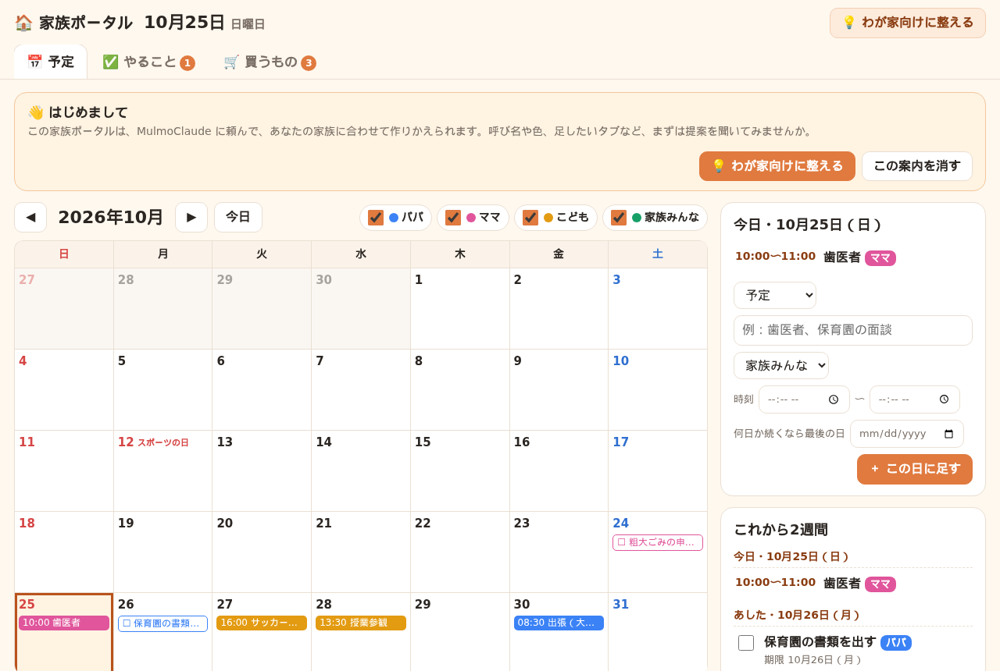
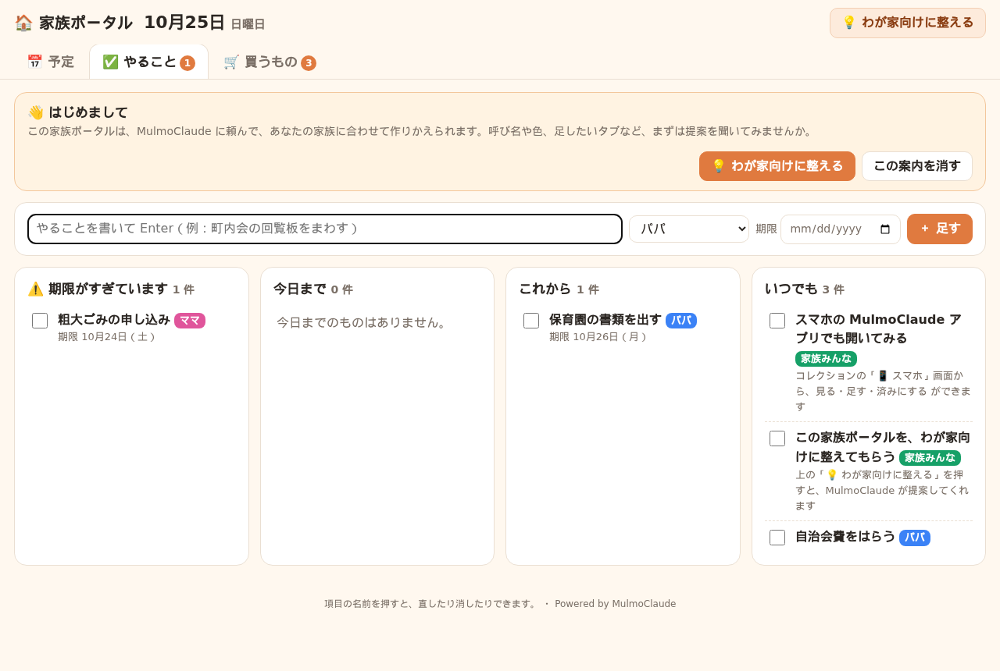
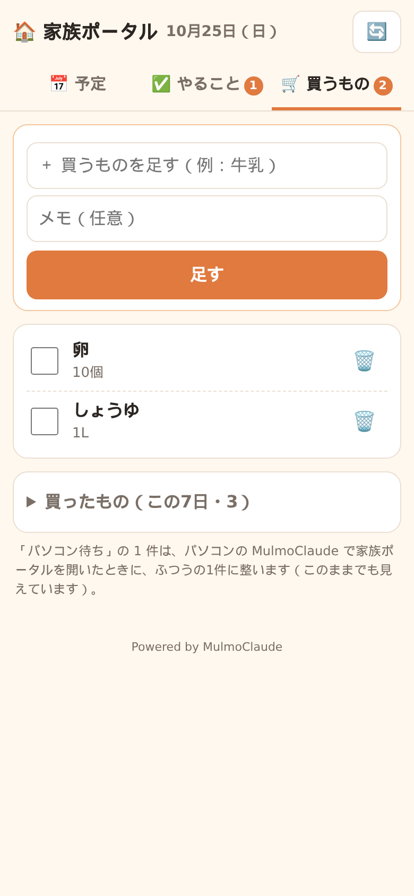

# 🏠 家族ポータル（MulmoClaude のコレクション）

家族の **予定・やること・買うもの** を1枚にまとめる、家族の掲示板です。
[MulmoClaude](https://github.com/receptron/mulmoclaude) のコレクションだけで動きます。サーバーや外のサービスはいりません。

入れたあと **「💡 わが家向けに整える」** を押すと、MulmoClaude があなたの家族に合わせた作りかえを提案してくれます（呼び名と色、くり返しの予定、お店ごとの買い物リスト、献立のタブ など）。



| やること | 買うもの（スマホ） |
|---|---|
|  |  |

※画面は見本です。

## できること

- 📅 **予定**：月のカレンダーに、だれの予定かを色分けで表示。日付を押して書けば足せます。祝日つき。右側に「今日」と「これから2週間」。
- ✅ **やること**：期限すぎ・今日まで・これから・いつでも、に分けて表示。済んだらチェック。
- 🛒 **買うもの**：気づいた人が書き足して、買ったらチェック。買ったものは7日間だけ下に残ります。
- 📱 **スマホ**：MulmoClaude のスマホアプリで、同じ中身を見る・足す・チェックする・消すができます。
- 💡 **わが家向けに整える**：MulmoClaude が質問して、提案して、OK をもらった分だけ作りかえます。作りかえる前に控えを取るので、元にも戻せます。
- 💬 チャットで「来週の水曜に歯医者を入れて」「牛乳を買うものに足して」と頼むこともできます。

## 入れ方

### いちばん簡単な方法：MulmoClaude に頼む

MulmoClaude のチャットに、次の文をそのまま貼って送ってください（`<このページのURL>` は、いま見ている GitHub のページの URL に置きかえます）。

```
次の GitHub リポジトリにある family-portal フォルダを、コレクションとして入れてください。
<このページのURL>
入れ方は、リポジトリの README の「AI 向けの入れ方」に書いてあります。
```

入ったら、左のメニューのコレクション一覧に「🏠 家族ポータル」が出ます。開いて、上の「🏠 家族ポータル」の画面を選んでください。

### 自分で置く方法

1. このリポジトリの `family-portal` フォルダの中身を、MulmoClaude のワークスペースの `data/skills/family-portal/` に置く（`seed` フォルダは除く）。
2. `family-portal/seed/items/` の中身を、`data/family-portal/items/` に置く（見本の記録。いらなければ `settings.json` だけでも大丈夫です）。
3. MulmoClaude のチャットで「family-portal のコレクションを読み込み直して」と頼むと、一覧に出ます。

### AI 向けの入れ方

（MulmoClaude がこの README を読んで入れるときの手順です）

1. このリポジトリを、ワークスペースの `github/` の下に clone する（同じ名前のフォルダがあれば `git pull`）。
2. `config/helps/collection-skills.md` を読み、このワークスペースでスキルを書く場所（`data/skills/<slug>/` か `.claude/skills/<slug>/`）を確かめる。slug は `family-portal`。もう同じ slug があれば、上書きせずにユーザーに別の名前を聞く。
3. `family-portal/views/*.html` を、スキルのフォルダの `views/` に写す。
4. `SKILL.md`、`schema.json`、`templates/customize.md` を、Write ツールでスキルのフォルダに書く（`data/skills` に書く環境では、Write / Edit で書いたときだけ MulmoClaude に読み込まれるため）。slug を変えたときは、`schema.json` の `dataPath` と `SKILL.md` の `name` も合わせる。
5. 記録のフォルダ（`schema.json` の `dataPath`）が空なら、`family-portal/seed/items/*.json` を `manageCollection` の `putItems`（`mode: "create"`）で入れる。空でなければ入れない。
6. `manageCollection` の `getSchema` で読み込まれたことを確かめ、`presentCollection` でコレクションを出す。最後に「上の『💡 わが家向けに整える』を押すと、家族に合わせた作りかえを提案します」と伝える。

## はじめに

1. コレクションを開くと「👋 はじめまして」の案内が出ます。
2. **「💡 わが家向けに整える」** を押すと、MulmoClaude との新しいチャットが下書きで開きます。送ると、家族の呼び名や、足したいものを聞かれます。
3. 選んで答えると、変えることの一覧と大きさの目安が出ます。OK すると作りかえが始まります。

あとからでも、コレクションの上の「💡 わが家向けに整える」ボタンや、チャットで「家族ポータルに献立のタブを足したい」と頼めば、同じ流れになります。

## しくみ

- 1件の予定・やること・買うものが、1つの JSON ファイルです（`data/family-portal/items/`）。
- 家族の呼び名と色は、「設定」の記録（`settings.json`）に入っています。
- MulmoClaude のスマホアプリの画面は、決まりで「新しい1件」を作れません。そのため、スマホで足したものは設定の記録の受け箱にいったん入り、パソコンの「🏠 家族ポータル」画面を開いたときに、自動でふつうの1件に分かれます。スマホでは「パソコン待ち」と出ますが、そのままでも見えていて、チェックや消すこともできます。

## 安全について

- 中身は、あなたのパソコンの MulmoClaude のワークスペースの中にだけ保存されます。外のサービスには送りません。
- 外出先のスマホからは、MulmoClaude のスマホアプリを通して見ます。家のパソコンに、外からの入口を開ける必要はありません。
- スマホの画面からできるのは「済み」の書きかえ、受け箱への書き足し、1件を消すことだけです。それ以外の書きかえは MulmoClaude 側ではじかれます。
- 「💡 わが家向けに整える」では、作りかえる前に必ず内容を見せて OK をもらい、控えを取ってから変えます。記録を勝手に消しません。

## できないこと

- **決まった時刻にスマホへ通知を送ることはできません。** MulmoClaude のベル（🔔）は、MulmoClaude の画面の中に出るものです。時刻で知らせてほしいときは、「💡 わが家向けに整える」で Google カレンダーとの連携を相談してください。
- パソコンの MulmoClaude が動いていないと、スマホからは見られません。
- 2人が同時にスマホから足すと、まれに片方が消えることがあります（足した直後に一覧で確かめてください）。

## 入っているもの

```
family-portal/
  SKILL.md                 MulmoClaude 向けの説明（記録の形、頼まれたときの動き）
  schema.json              コレクションの設計図
  views/board.html         パソコンの画面（予定・やること・買うもの）
  views/phone.html         スマホの画面
  templates/customize.md   「💡 わが家向けに整える」の手順書
  seed/items/              見本の記録（設定1件、やること2件、買うもの2件）
docs/                      README の画像
```

## ライセンス

MIT No Attribution（MIT-0）。自由に使って、作りかえて、配ってかまいません。表記もいりません。
個人の作例として公開しているもので、動作の保証やサポートはありません。

---

## English (short)

A family bulletin board for [MulmoClaude](https://github.com/receptron/mulmoclaude): shared **calendar, to-dos and shopping list**, built only from a MulmoClaude collection (no server, no external services). After installing, press **"💡 わが家向けに整える" (Customize for my family)** and MulmoClaude asks a few questions, proposes changes (member names and colors, recurring events, per-store shopping lists, a meal-plan tab, …) and applies only what you approve, after backing up the files.

To install, paste this into a MulmoClaude chat: *"Install the family-portal folder of `<this repo URL>` as a collection, following the 'AI 向けの入れ方' section of its README."* The UI text is Japanese. License: MIT-0.
